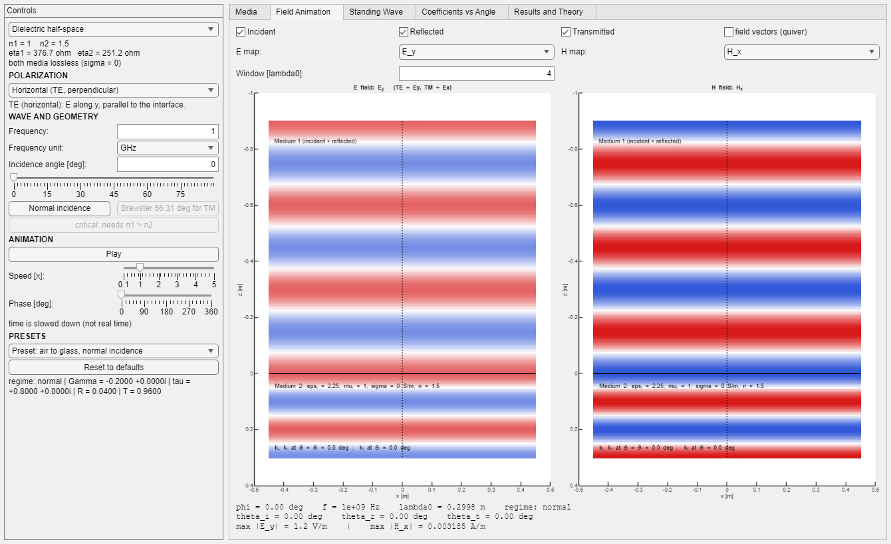
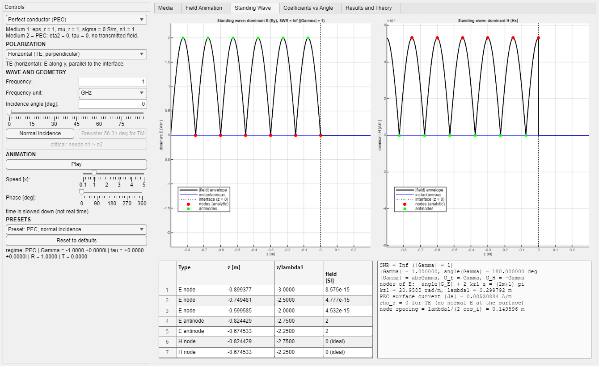
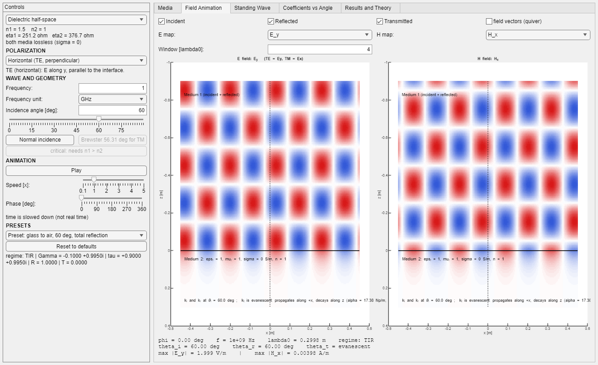

<div dir="rtl">

# آزمایشگاه مجازی امواج الکترومغناطیسی — EM Virtual Lab


**[English README](README.md)** · **[راهنمای کامل PDF](docs/EM_VirtualLab_UserGuide_FA.pdf)**

یک آزمایشگاه مجازی تعاملی در متلب برای مشاهدهٔ برخورد موج تخت الکترومغناطیسی با
مرز میان دو محیط: بازتاب و شکست، ضرایب TE و TM، بازتاب کلی و موج میرا، موج ایستا
روی رسانای کامل، و محیط‌های با اتلاف و مغناطیسی.



پروژهٔ درس **میدان‌ها و امواج**. تمام روابط فیزیکی در
[`docs/SPECIFICATION.md`](docs/SPECIFICATION.md) آمده است، بنابراین هر عددی که
برنامه نشان می‌دهد به یک رابطهٔ درسی قابل ردیابی است.

---

## فهرست

- [ویژگی‌ها](#ویژگیها)
- [اجرا در سه گام](#اجرا-در-سه-گام)
- [پنج تب برنامه](#پنج-تب-برنامه)
- [ثابت‌های محیط](#ثابتهای-محیط)
- [آزمون‌ها و اعتبارسنجی](#آزمونها-و-اعتبارسنجی)
- [ساختار پروژه](#ساختار-پروژه)
- [مستندات](#مستندات)
- [محدودیت‌ها](#محدودیتها)
- [پروانه و نحوهٔ ساخت](#پروانه-و-نحوهٔ-ساخت)

---

## ویژگی‌ها

- **پنج تب**: `Media`، `Field Animation`، `Standing Wave`، `Coefficients vs Angle` و `Results and Theory`
- **هر محیط با سه ثابت مستقل**: گذردهی نسبی `eps_r`، تراوایی نسبی `mu_r` و رسانندگی `sigma` — یعنی محیط با اتلاف و مغناطیسی هم پشتیبانی می‌شود، نه فقط دی‌الکتریک آرمانی
- **ده سناریوی آماده**: هوا به شیشه، زاویهٔ بروستر، بازتاب کلی، رسانای کامل، FR-4 با اتلاف، آب دریا و محیط مغناطیسی
- **انیمیشن میدان** با توقف و تنظیم سرعت، و نمایش هم‌زمان میدان الکتریکی و مغناطیسی
- **زاویهٔ بروستر و بحرانی** محاسبه و روی نمودارها علامت‌گذاری می‌شوند؛ در محیط مغناطیسی زاویهٔ بروستر به قطبش TE منتقل می‌شود و برنامه همین را نشان می‌دهد
- **اعتبارسنجی واقعی**: آزمون‌های فیزیک T1 تا T12، آزمون خودکار رابط گرافیکی با ۴۹ بررسی، و پویش ۱۰۶ حالت برای یافتن خطاهای پنهان
- **راهنمای فارسی PDF** ساخته‌شده با XeLaTeX، با فهرست مطالب واقعی، فهرست شکل‌ها و ۱۷ تصویر

## اجرا در سه گام

۱. متلب **R2021a یا جدیدتر** را باز کنید (هیچ جعبه‌ابزاری لازم نیست).

۲. در پنجرهٔ فرمان به پوشهٔ پروژه بروید:

```matlab
cd path\to\EM_VirtualLab
```

۳. اجرا کنید:

```matlab
run_lab
```

پنجره با پنج تب باز می‌شود و پنل سمت چپ فقط کنترل‌های پرکاربرد را دارد، بنابراین
همهٔ دکمه‌ها (از جمله Play/Pause و پیش‌تنظیم‌ها) بدون اسکرول دیده می‌شوند.

> اگر پنجره‌ای به‌دلیل ویرایش فایل‌ها هنگام اجرا بسته نشد، در پنجرهٔ فرمان بنویسید:
> `delete(findall(groot,'Type','figure'))` و دوباره `run_lab` را اجرا کنید.

## پنج تب برنامه

| تب | چه چیزی نشان می‌دهد |
|---|---|
| **Media** | شش ثابت محیط، انتخاب مادهٔ آماده، جابه‌جایی دو محیط، و گزارش محاسبه‌شدهٔ `n`، `η`، `λ`، `α`، تانژانت اتلاف و عمق پوست |
| **Field Animation** | دو نقشهٔ رنگی میدان E و H، جهت‌های انتشار و زاویه‌ها، انیمیشن با تنظیم سرعت |
| **Standing Wave** | پوش و مقدار لحظه‌ای میدان، گره‌ها و شکم‌ها، جدول مکان‌ها و `SWR` |
| **Coefficients vs Angle** | چهار نمودار اندازه و فاز `Γ` و `τ` برحسب زاویه، با علامت زاویهٔ بروستر و بحرانی |
| **Results and Theory** | پنل عددی کامل با واحدها در کنار پنل فرمول‌ها |



## ثابت‌های محیط

| کمیت | معنا | رنج مجاز | پیش‌فرض |
|---|---|---|---|
| `eps_r` | گذردهی نسبی | بزرگ‌تر از صفر تا ۱۰⁴ | ۱ و ۲٫۲۵ |
| `mu_r` | تراوایی نسبی | بزرگ‌تر از صفر تا ۱۰⁴ | ۱ |
| `sigma` | رسانندگی (S/m) | ۰ تا ۱۰⁹ | ۰ |
| `f` | بسامد | ۱ مگاهرتز تا ۱۰۰ گیگاهرتز | ۱ گیگاهرتز |
| `θ_i` | زاویهٔ فرود | ۰ تا ۸۹٫۹ درجه | ۰ |

با مثبت‌شدن `sigma` محیط اتلافی می‌شود و برنامه با گذردهی مختلط کار می‌کند؛ با
`mu_r ≠ 1` محیط مغناطیسی می‌شود. برای رسیدن به **بازتاب کلی** کافی است در تب
`Media` دکمهٔ **Swap media** را بزنید تا محیط ۱ غلیظ‌تر از محیط ۲ شود.



## آزمون‌ها و اعتبارسنجی

```matlab
cd tests
test_core        % آزمون‌های T1 تا T12 فیزیک هستهٔ محاسباتی
smoke_gui        % آزمون خودکار رابط گرافیکی (۴۹ بررسی، بدون نمایش)
fuzz_probe       % پویش ۱۰۶ حالت برای یافتن خطاهای عددی پنهان
```

نتیجهٔ آخرین اجرا:

| آزمون | نتیجه |
|---|---|
| `test_core` | **۱۲ از ۱۲ PASS** |
| `smoke_gui` | **۴۹ بررسی، ۰ خطا** |
| `fuzz_probe` | **۱۰۶ حالت، ۰ خطا** |

جدول کامل مقایسهٔ «مقدار تحلیلی» با «مقدار محاسبه‌شده» در
[`docs/VALIDATION.md`](docs/VALIDATION.md) آمده است (۳۷ ردیف). شرط‌های مرزی روی
آرایه‌های میدان با خطای کمتر از ۶×۱۰⁻¹⁶ بررسی می‌شوند و برابری `R + T = 1` در
هر دو قطبش کنترل می‌شود.

## ساختار پروژه

```
EM_VirtualLab/
├── run_lab.m              ← نقطهٔ شروع
├── core/                  ← فیزیک، بدون هیچ کد گرافیکی
│   ├── em_constants.m     ثابت‌های فیزیکی (تنها جای تعریف)
│   ├── em_defaults.m      مقادیر پیش‌فرض و اعتبارسنجی ورودی‌ها
│   ├── em_solve.m         اسنل، فرنل، بروستر، بحرانی، PEC، محیط اتلافی
│   ├── em_fields.m        فازورهای سه موج و میدان کل
│   ├── em_standing_wave.m پوش، گره و شکم، SWR، جریان و بار سطحی
│   └── em_angle_sweep.m   ضرایب برحسب زاویه
├── gui/EM_VirtualLab.m    ← کل رابط گرافیکی (بدون فایل .mlapp)
├── tests/                 ← آزمون‌ها و تولید شکل‌ها و راهنما
├── docs/                  ← مستندات و راهنمای فارسی PDF
└── figures/               ← شکل‌ها و تصاویر برنامه
```

## مستندات

| فایل | توضیح |
|---|---|
| [راهنمای فارسی PDF](docs/EM_VirtualLab_UserGuide_FA.pdf) | راهنمای کامل ۲۳ صفحه‌ای با ۱۷ تصویر |
| [`docs/SPECIFICATION.md`](docs/SPECIFICATION.md) | مشخصات کامل فیزیکی و خواسته‌های پروژه |
| [`docs/THEORY_MAP.md`](docs/THEORY_MAP.md) | نگاشت هر رابطه به تابعی که آن را پیاده می‌کند + پاسخ پرسش‌های دفاع شفاهی |
| [`docs/VALIDATION.md`](docs/VALIDATION.md) | جدول مقایسهٔ تحلیلی و عددی |
| [`docs/USER_GUIDE.md`](docs/USER_GUIDE.md) | راهنمای گام‌به‌گام فارسی (متنی) |
| [`docs/REPORT_DRAFT.md`](docs/REPORT_DRAFT.md) | گزارش فنی فارسی |
| [`docs/STATUS.md`](docs/STATUS.md) | دفتر ثبت توسعه، شامل خطاهای یافت‌شده و نحوهٔ رفع آن‌ها |

## محدودیت‌ها

- محیط‌ها همسان‌گرد هستند؛ اتلاف مغناطیسی (`mu_r` مختلط) مدل نشده است.
- محیط با اتلاف زاویهٔ بروستر دقیق و بازتاب کلی واقعی ندارد.
- اگر محیط ۱ اتلافی باشد، `SWR` تعریف‌نشده گزارش می‌شود.
- برخورد مایل دوبعدی است؛ نمای سه‌بعدی پرتو پیاده‌سازی نشده است.
- فاز انیمیشن با زمان واقعی متناسب نیست (نمایش آهسته و آموزشی).

## پروانه و نحوهٔ ساخت

پروانه: **MIT** — فایل [LICENSE](LICENSE).

کد، آزمون‌ها، شکل‌ها و راهنماها با کمک یک دستیار هوش مصنوعی نوشته شده‌اند
(استفاده از هوش مصنوعی در این درس مجاز است) و سپس با **اجرای واقعی** اعتبارسنجی
شده‌اند: مجموعه‌آزمون فیزیک، آزمون بدون‌نمایش رابط گرافیکی و پویش حالت‌ها هنگام
هر تغییر اجرا می‌شوند و اعداد `docs/VALIDATION.md` با رابطه‌های بستهٔ مستقل
مقایسه می‌گردند. دفتر ثبت توسعه عمداً در مخزن نگه داشته شده است، چون مسیر
یافتن و رفع خطاها به‌اندازهٔ نتیجه آموزنده است.

</div>
