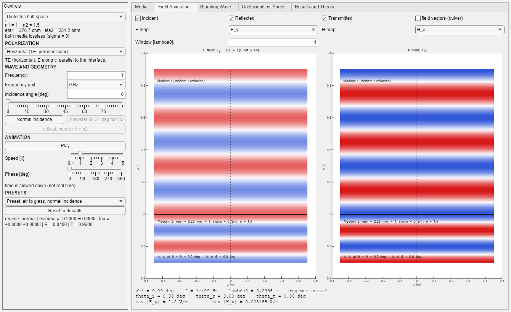

# EM Virtual Lab — MATLAB virtual laboratory


**English** · **[فارسی](README.fa.md)** · **[Persian PDF guide](docs/EM_VirtualLab_UserGuide_FA.pdf)**

Interactive visualisation of electromagnetic plane-wave interaction with the
boundary between two media: **reflection and refraction, TE/TM coefficients,
total reflection and the evanescent wave, the standing wave in front of a
perfect conductor, and lossy / magnetic media.**



Course project for *Fields and Waves* (میدان‌ها و امواج). The physics is specified
in full in [`docs/SPECIFICATION.md`](docs/SPECIFICATION.md) (Section 3), so every
number the app prints can be traced to a textbook formula.

**Highlights**

- Five tabs: *Media*, *Field Animation*, *Standing Wave*, *Coefficients vs Angle*, *Results and Theory*
- Each medium is entered by its own `eps_r`, `mu_r` and `sigma` — lossy and magnetic media are supported, not just the ideal dielectric
- Ten presets, including total reflection, a PEC, FR-4, sea water and a magnetic medium where the Brewster angle moves to TE
- Every displayed quantity is checked against theory: **T1–T12** physics tests, a **49-check** headless GUI test and a **106-state** fuzz sweep
- Persian (RTL) PDF user guide built with XeLaTeX, with a real table of contents and 17 figures

---

## Contents

1. [How to run](#1-how-to-run-three-steps)
2. [What is in the folder](#2-what-is-in-the-folder)
3. [Medium parameters](#3-medium-parameters--the-main-controls)
4. [Assumptions and deviations](#4-assumptions-d1d7-of-the-specification-and-deviations)
5. [Requirements coverage](#5-requirements-r1r12--where-to-see-them)
6. [Verification status](#6-verification-status-what-was-actually-executed)
7. [Limitations](#7-limitations)
8. [License](#8-license)
9. [How this was built](#9-how-this-built)

---

## 1. How to run (three steps)

1. Start MATLAB **R2021a or newer** (no toolbox is required, base MATLAB only).
2. In the MATLAB command window go to the project folder:
   ```matlab
   cd path\to\EM_VirtualLab
   ```
3. Run the launcher:
   ```matlab
   run_lab
   ```

The window opens with five tabs — **Media | Field Animation | Standing Wave |
Coefficients vs Angle | Results and Theory** — and the left control panel holds
only what you touch while animating, so every control (including Play/Pause and
the presets) is visible without scrolling.

If a window ever refuses to close because the `.m` file was edited while the app
was running, run `delete(findall(groot,'Type','figure'))` and start again.

To check the physics from the command line instead:

```matlab
cd tests
test_core        % T1 ... T12, prints a PASS/FAIL table (must all PASS)
smoke_gui        % builds the app headless, fires every callback, must print SMOKE TEST PASSED
gen_report_figures   % regenerates figures/ and docs/VALIDATION.md
gen_guide_figures    % regenerates the guide's Media-state screenshots
python tests/build_guide_tex.py     % regenerate the guide's LaTeX source
python tests/compile_guide_tex.py   % XeLaTeX x3 -> the guide PDF
uv run --with fonttools python tests/check_guide_glyphs.py   % glyph audit
fuzz_probe           % diagnostic: walks 106 states and asserts that every
                     % graphics object is finite and no panel shows 'NaN'
```

## 2. What is in the folder

```
EM_VirtualLab/
  run_lab.m                  launcher: adds paths and starts the GUI
  core/                      physics, completely free of GUI code
    em_constants.m           c, mu0, eps0, eta0 (the single place constants live)
    em_defaults.m            default parameters + ALL input validation
    em_solve.m               Snell, Fresnel (TE/TM), Brewster, critical, PEC,
                             lossy and magnetic media (complex eps, n, eta)
    em_fields.m              phasors of incident/reflected/transmitted + totals
    em_standing_wave.m       envelopes, nodes/antinodes, SWR, PEC Js and rho_s
    em_angle_sweep.m         coefficients versus incidence angle (both pols)
  gui/
    EM_VirtualLab.m          the whole app (programmatic uifigure, no .mlapp)
  tests/
    test_core.m              T1-T12 verification suite
    smoke_gui.m              headless GUI smoke test
    gen_report_figures.m     report figures (200 dpi) + validation table
  docs/
    CONTRACT.md              frozen interfaces and conventions
    STATUS.md                task list with status and deviations
    THEORY_MAP.md            every formula -> the function that implements it
    USER_GUIDE.md            step-by-step guide (Persian)
    REPORT_DRAFT.md          technical report draft (Persian)
    VALIDATION.md            analytic vs computed table (generated)
    EM_VirtualLab_UserGuide_FA.pdf   Persian user guide (XeLaTeX + XePersian,
                                     B Nazanin + Times New Roman), 23 pages,
                                     real TOC + list of figures, 17 figures
    EM_VirtualLab_UserGuide_FA.tex   the editable LaTeX source of that guide
    build/                           LaTeX build artefacts (not deliverables)
  figures/                   generated PNG figures and GUI snapshots
```

## 3. Medium parameters — the main controls

Every medium is entered by its **electromagnetic constants**, so any of them can
be changed directly in the GUI:

| Input | Meaning | Range | Default |
|-------|---------|-------|---------|
| `eps_r1`, `eps_r2` | relative permittivity | `(0, 1e4]` | 1 / 2.25 |
| `mu_r1`, `mu_r2` | relative permeability | `(0, 1e4]` | 1 / 1 |
| `sigma1`, `sigma2` | conductivity [S/m] | `[0, 1e9]` | 0 / 0 |

* **`sigma > 0` makes a medium lossy.** The core then uses the complex
  permittivity `eps_c = eps_r - j*sigma/(omega*eps0)`, a complex index
  `n = sqrt(eps_c*mu_r)` and a complex impedance `eta = eta0*sqrt(mu_r/eps_c)`,
  and reports the loss tangent `tan(delta) = sigma/(omega*eps0*eps_r)`, the
  attenuation constant `alpha = -Im(kz)` and the skin depth `delta_s = 1/alpha`.
  Inside such a medium `|E|` decays as `exp(-alpha*z)` and the power as
  `exp(-2*alpha*z)`.
* **`mu_r != 1` makes a medium magnetic**: `n = sqrt(eps_r*mu_r)` and
  `eta = eta0*sqrt(mu_r/eps_r)`. This changes *which polarization* has a
  Brewster angle: for `eps_r = 2.25` with `mu_r = 4` the TE angle exists at
  `43.09 deg` and the TM one does not exist at all (the opposite of the usual
  non-magnetic case). The angle is then found by minimising `|Gamma|`.
* **`Swap media 1 <-> 2`** exchanges the six constants — the easy way to make
  `n1 > n2` and reach total reflection.
* **Quick material (medium 2)** fills medium 2 with air, glass, Teflon, water,
  FR-4 (`4.4, 1, 0.02`), sea water (`81, 1, 4`) or ferrite (`12, 4, 0`).

Two physics points the app makes explicit (they are easy to get wrong):

1. **At the interface `R + T = 1` even for a lossy half-space.** The absorption
   does not appear at the boundary; it appears as the decay of the transmitted
   wave inside medium 2. Verified to 1e-14 for both polarizations (test T11).
2. **A lossy medium has no exact Brewster angle and no true total reflection**:
   `|Gamma|` only has a minimum, and the app reports `none`.

## 4. Assumptions (D1–D7 of the specification) and deviations

The full list is in `docs/CONTRACT.md`; the short version:

* **D1** one app on one shared core: a single GUI with a *Mode* selector
  (Dielectric / PEC).
* **D2** SI units; time dependence `exp(+j*omega*t)` so phasors vary as
  `exp(-j*k·r)`; incident amplitude `E0 = 1 V/m`; interface at `z = 0`,
  medium 1 at `z < 0`, plane of incidence = x–z plane; plots are drawn with the
  z axis reversed so medium 1 is on top. Degrees at the API boundary, radians
  inside the core.
* **D3** medium 1 is air by default but accepts any `eps_r1, mu_r1, sigma1`;
  `eps_r < 1` is accepted although it is **not** a physical passive lossless
  dielectric (the core says nothing about it; the report documents it).
* **D4** Horizontal = TE (perpendicular, *s*); Vertical = TM (parallel, *p*).
  At normal incidence both give the same coefficients and differ only in the
  direction of E.
* **D5** **Sign convention:** `Gamma` and `tau` are E-amplitude ratios along the
  reference directions of Section 3.4 of the specification
  (Cheng/Hayt/Ulaby convention), so `Gamma_TM = Gamma_TE` at normal incidence.
  Several textbooks flip the sign of `Gamma_TM` (and the reflected E direction
  for TM) — see `docs/THEORY_MAP.md`, question 2.
* **D6** incidence angle `0 … 89.9 deg` (90 deg is excluded because
  `cos = 0`); frequency with an MHz/GHz dropdown (default 1 GHz); the spatial
  window is sized in free-space wavelengths (default 3 λ0 in x, 4 λ0 in z).
* **D7** conductivity is implemented (it was an optional extension in the plan)
  and so are magnetic media; magnetic *loss* (a complex `mu_r`) is not modelled.

Documented deviations from the interface contract (see `docs/STATUS.md`,
"Deviation log"): `core/em_constants.m` was added so that constants live in one
place; several purely additive struct fields were added for the GUI and tests;
the standing-wave envelopes are returned as the physical envelopes of the
dominant components together with the reference coefficients
`W.GE = Gamma`, `W.GH = -Gamma`; the k-vector arrows in the Field Animation tab
were removed on the user's request in favour of a text description of the
propagation directions.

## 5. Requirements R1–R12 → where to see them

| Req. | What is asked | Where it is shown in the app / code |
|------|---------------|-------------------------------------|
| R1 | medium 1 air, medium 2 dielectric (`mu_r = 1`, `eps_r` input) or PEC | **Media tab**: six constants (`eps_r`, `mu_r`, `sigma` per medium), *Quick material*, *Swap media 1 <-> 2*, plus a computed report box; core `em_solve` |
| R2 | normal and oblique incidence, user sets angle and frequency | *Incidence angle* edit + slider + *Normal incidence* button; *Frequency* + unit dropdown |
| R3 | user selects horizontal or vertical polarization | *Polarization* dropdown (shows both names) |
| R4 | show incident, reflected, transmitted waves with E, H and directions | *Field Animation* tab: a display toolbar (incident/reflected/transmitted checkboxes, E and H component dropdowns, window size, quiver), two colour maps, and a text block giving the propagation directions and the angles θ_i, θ_r, θ_t (the k-vector arrows were removed on the user's request); the status strip repeats the three angles |
| R5 | show Γ and τ (magnitude and phase) and plot them versus angle | *Coefficients vs Angle* tab: \|Γ\|, ∠Γ, \|τ\|, ∠τ versus θ_i, TE and TM, plus a R/T power toggle |
| R6 | PEC: standing wave with nodes and antinodes | *Standing Wave* tab in PEC mode: envelope, instantaneous curve, markers, table of positions, SWR, \|Js\|, ρ_s |
| R7 | dielectric: reflection and refraction angles and the fields in both media | *Field Animation* tab and *Results and Theory* tab (θ_r, θ_t, k vectors) |
| R8 | Brewster and critical angles computed and marked on the plots | *Results and Theory* tab prints them; *Coefficients* tab draws θ_B (only where it exists — for magnetic media that can be the TE curve) and θ_c as vertical markers; buttons that show the angle in their own label when it exists (*Brewster 56.31 deg*, *critical 41.81 deg*) and the reason when it does not (*Brewster 56.31 deg for TM*, *critical: needs n1 > n2*), with a tooltip explaining what to change |
| R9 | total reflection: show the evanescent field in medium 2 | *Field Animation* tab: the medium-2 decay is drawn and the direction text states "k_t is evanescent … (α, δ)"; *Standing Wave* tab shows `exp(-α z)` with the δ marker |
| R10 | field animation with pause and speed control | *Play/Pause* button, *Speed* slider (0.1×–5×), *Phase* slider; note "animation time is slowed down" |
| R11 | numeric results, physical formulas and computational parameters in the GUI | *Results and Theory* tab: numeric panel with units (including `eps_c`, `n`, `eta`, `alpha`, skin depth, loss tangent), formula panel (LaTeX, plain-text fallback), grid/window/phase-step parameters |
| R12 | runnable software, organised commented .m files, report, user guide | `run_lab.m`, `core/`, `gui/`, `tests/`, `docs/USER_GUIDE.md`, `docs/REPORT_DRAFT.md` |

## 6. Verification status (what was actually executed)

Executed on this machine, MATLAB R2024a (24.1.0.2628055):

* `tests/test_core.m` — **T1 … T12 all PASS**: constants and media; textbook
  reference values; boundary conditions evaluated on the field arrays
  (max tangential jump ≤ 6e-16 including total reflection); power balance and
  Poynting-vector continuity; η-form vs n-form; Snell and kx conservation; the
  limits θ→0, θ→90°, ε2 = ε1 and the Stokes relation; evanescent decay with
  `exp(-α δ) = exp(-1)`; analytic vs numeric node positions; angle-sweep
  consistency; **T11 lossy media** (complex permittivity and loss tangent,
  `alpha` against the standard closed form, `exp(-α z)` and `exp(-2α z)` decay,
  `R + T = 1` at the interface for both polarizations, boundary conditions with
  the complex permittivity); **T12 magnetic media** (`n` and `η` from
  `eps_r, mu_r`, the TE Brewster angle against its closed form, no TM Brewster
  angle, the analytic non-magnetic result recovered when `mu1 = mu2`).
* `tests/smoke_gui.m` — **SMOKE TEST PASSED**, 49 checks, 0 failures: the app is
  built headless, every preset (ten of them) is applied with both polarizations,
  30 animation frames are stepped each time, every rendered array and the
  numeric panel are checked for NaN/Inf, **every widget callback is fired once**,
  and the app is closed **through the window's own CloseRequestFcn**.
* `tests/repo_checks.py` — repository hygiene (ASCII-only `.m` files, no private
  paths, every README link resolves, Python helpers compile, no raw Unicode math
  in the guide). This is what the GitHub Actions workflow runs; MATLAB itself
  cannot run on a public runner, so the three suites above are executed locally
  and their results recorded here.
* `tests/fuzz_probe.m` — diagnostic sweep: **106 states, 0 failures** (see
  `docs/STATUS.md`, entries 18 and 21, for the defects it found and fixed; it
  also checks that no plotted array is complex, since MATLAB plots only the real
  part of complex data without warning).
* `tests/gen_report_figures.m` — writes 18 PNGs into `figures/` (200 dpi,
  including real `exportapp` snapshots of the running app) and
  `docs/VALIDATION.md` (37 analytic-vs-computed rows).

The GUI was therefore executed **programmatically, including its callbacks** —
but no human has clicked through it on screen: run `run_lab` once yourself
before the presentation and check the layout, fonts and the animated colours on
your monitor.

## 7. Limitations

* Magnetic **loss** is not modelled (`mu_r` is real); conductivity is modelled.
* A **lossy** medium has no exact Brewster angle and no true total reflection:
  the app reports "none" for θ_B and labels the regime `lossy`.
* If **medium 1** is lossy the standing wave is not periodic, so `SWR` is
  reported as "not defined" and the analytic node/antinode positions are
  replaced by numerically detected extrema.
* The transmitted power fraction uses `Re(cos_t/eta2)` for TE but
  `Re(cos_t/conj(eta2))` for TM; for real (lossless) `eta` both reduce to the
  textbook `(eta1/eta2) cos_t/cos_i`. This is what keeps `R + T = 1` exactly for
  lossy media.
* Oblique incidence is two-dimensional (x–z plane); a 3-D ray view with
  Poynting arrows and a GIF export are **not** implemented (optional stretch).
* `|Gamma| = 1` gives `SWR = Inf`; the app prints `Inf` instead of a number.
* The animation phase advances by a fixed step per frame, independent of the
  real frequency — the animation is a slow-motion stroboscope by design.

## 8. License

MIT — see [LICENSE](LICENSE).

## 9. How this was built

The code, tests, figures and both guides were written with an AI coding assistant
(the course explicitly permits AI use), then verified by execution: the physics
suite, the headless GUI suite and the fuzz sweep all run on every change, and the
numbers in `docs/VALIDATION.md` are compared against independently written
closed-form expressions. `docs/STATUS.md` is the running development log,
including the bugs that were found and how they were fixed — it is kept in the
repository on purpose, because the failure modes are as instructive as the
result.
