# گزارش فنی — آزمایشگاه مجازی امواج الکترومغناطیسی (EM Virtual Lab)

**درس:** میدان‌ها و امواج — **موضوع:** بازتاب و عبور موج تخت از مرز دو محیط — **محیط اجرا:** MATLAB R2021a یا جدیدتر، فقط قابلیت‌های پایه

---

## ۱. هدف پروژه

هدف، ساختن آزمایشگاه مجازی تعاملی برای برخورد موج تخت الکترومغناطیسی با مرز دو محیط است. هر محیط با سه ثابت الکترومغناطیسی خود توصیف می‌شود: `eps_r`، `mu_r` و `sigma`؛ بنابراین دو محیط می‌توانند بدون اتلاف یا با اتلاف (`sigma > 0`)، غیرمغناطیسی یا مغناطیسی (`mu_r ≠ 1`) باشند و محیط ۲ می‌تواند به‌جای نیم‌فضای دی‌الکتریک، رسانای کامل الکتریکی (PEC) باشد. برنامه موج‌های فرودی، بازتابی و عبوری را با میدان‌های E و H و جهت انتشار نمایش می‌دهد؛ ضرایب بازتاب و عبور (اندازه و فاز) را عددی و نموداری برحسب زاویهٔ فرود می‌دهد؛ در PEC موج ایستا و گره‌ها و شکم‌ها را نشان می‌دهد؛ زاویه‌های بروستر و بحرانی را علامت‌گذاری می‌کند؛ زیر بازتاب کلی میدان میرا را نمایش می‌دهد؛ در محیط با اتلاف افت نمایی موج عبوری، تانژانت اتلاف و عمق پوست را گزارش می‌کند؛ انیمیشن میدان با کنترل توقف و سرعت دارد؛ و نتایج عددی، فرمول‌ها و پارامترهای محاسباتی را داخل رابط گزارش می‌کند. خروجی، نرم‌افزار اجراشدنی، ماژول‌های توضیح‌دار، همین گزارش و راهنمای کاربر است.

---

## ۲. مبانی نظری

### ۲.۱ هندسه، نمادها و قراردادها

مرز `z = 0` است؛ محیط ۱ در `z < 0`، محیط ۲ در `z > 0`، صفحهٔ فرود x-z و محور y عمود بر آن. وابستگی زمانی `exp(+jωt)`، پس فازورها `exp(-j k·r)`؛ دامنهٔ فرودی `E0 = 1 V/m`. برای هر محیط `k = 1, 2` با ثابت‌های `eps_k`، `mu_k` و `sigma_k`:

`eps_ck = eps_k - j sigma_k/(omega eps0)` (گذردهی نسبی مختلط)

`n_k = sqrt(eps_ck mu_k)` (ضریب شکست مختلط)

`eta_k = eta0 sqrt(mu_k/eps_ck)` ، `eta0 = mu0 c = 376.730` اهم (امپدانس ذاتی)

`k_k = n_k k0` با `k0 = omega/c = 2πf/c` ، `lambda_k = 2π/Re(k_k)`

با `sigma_k = 0` و `mu_k = 1` این روابط دقیقاً به حالت سادهٔ درس کاهش می‌یابند: `n_k = sqrt(eps_k)`، `eta_k = eta0/n_k`، `lambda_k = c/(n_k f)`، و همهٔ فرم‌های فرنل زیر عیناً همان فرم‌های کتاب می‌شوند.

نمادها: `theta_i` زاویهٔ فرود، `theta_r` زاویهٔ بازتاب، `theta_t` زاویهٔ شکست، `Gamma` ضریب بازتاب (نسبت دامنهٔ میدان الکتریکی بازتابی به فرودی در راستای مرجع هر قطبش)، `tau` ضریب عبور (نسبت دامنهٔ میدان الکتریکی عبوری به فرودی)، `R` و `T` کسرهای توان بازتابی و عبوری، `alpha` ثابت تضعیف در راستای z، `delta = 1/alpha` عمق نفوذ، `delta_s = 1/att` عمق پوست.

### ۲.۲ قانون اسنل و پایستگی عدد موج مماسی

پیوستگی فاز روی مرز یعنی مؤلفهٔ مماسی بردار موج در دو محیط یکی است:

`k1 sin(theta_i) = k2 sin(theta_t)` ⟹ `n1 sin(theta_i) = n2 sin(theta_t)`

این `kx = k1 sin(theta_i) = k2 sin(theta_t)` در همهٔ محاسبات به‌کار می‌رود و پایستگی‌اش در آزمون‌ها بررسی می‌شود. همچنین `theta_r = theta_i`. در محیط با اتلاف `n2` مختلط است و `sin(theta_t)` هم مختلط می‌شود؛ در آن حالت زاویهٔ شکست حقیقی وجود ندارد و برنامه `theta_t` را «complex (lossy)» گزارش می‌کند.

### ۲.۳ ضرایب فرنل در قطبش TE و TM

در TE (افقی، s) میدان E موازی سطح و عمود بر صفحهٔ فرود است؛ در TM (عمودی، p) میدان E در صفحهٔ فرود است. ضرایب نسبت دامنهٔ میدان الکتریکی‌اند:

`Gamma_TE = (eta2 cos(theta_i) - eta1 cos(theta_t)) / (eta2 cos(theta_i) + eta1 cos(theta_t))`، `tau_TE = 2 eta2 cos(theta_i) / (eta2 cos(theta_i) + eta1 cos(theta_t)) = 1 + Gamma_TE`

`Gamma_TM = (eta2 cos(theta_t) - eta1 cos(theta_i)) / (eta2 cos(theta_t) + eta1 cos(theta_i))`، `tau_TM = 2 eta2 cos(theta_i) / (eta2 cos(theta_t) + eta1 cos(theta_i))`، و `1 + Gamma_TM = tau_TM cos(theta_t) / cos(theta_i)`

فرم ضریب‌شکست هم همین را می‌دهد: `Gamma_TE = (n1 cos(theta_i) - n2 cos(theta_t)) / (n1 cos(theta_i) + n2 cos(theta_t))` و `Gamma_TM = (n1 cos(theta_t) - n2 cos(theta_i)) / (n1 cos(theta_t) + n2 cos(theta_i))`؛ برنامه هر دو صورت را مقایسه می‌کند.

علامت `Gamma_TM` به قرارداد جهات مرجع بستگی دارد. در این پروژه قرارداد Cheng/Hayt/Ulaby به‌کار رفته و نتیجه‌اش این است که در فرود عمودی `Gamma_TM = Gamma_TE` می‌شود. بعضی کتاب‌ها جهت مثبت میدان بازتابی TM را برعکس می‌گیرند و علامت `Gamma_TM` در آن‌ها قرینه است؛ اندازه‌ها، توان‌ها و زاویه‌های ویژه تغییری نمی‌کنند.

### ۲.۴ کسرهای توان

در حالت کلی (محیط دلخواه، از جمله با اتلاف) کسر توان عبوری از نسبت مؤلفهٔ عمودی بردار پوینتینگ میانگین‌زمانی در دو محیط می‌آید:

`R = |Gamma|^2` ، `T = |tau|^2 Re(cos(theta_t)/eta2) / Re(cos(theta_i)/eta1)` (TE)

و برای TM `T = |tau|^2 Re(cos(theta_t)/conj(eta2)) / Re(cos(theta_i)/conj(eta1))`. برای `eta` حقیقی (محیط بدون اتلاف) هر دو صورت به یک رابطه کاهش می‌یابند: `T = |tau|^2 (eta1/eta2) cos(theta_t)/cos(theta_i)`، و مجموع `R + T = 1` می‌شود.

ضریب `eta1/eta2` از نسبت امپدانس‌ها و ضریب `Re(cos(theta_t))/cos(theta_i)` از تصحیح سطح مقطع پرتو پس از شکست می‌آید؛ جاافتادن همین دو ضریب پرتکرارترین خطای این تمرین است. مجموع `R + T` هم در پنل نتایج چاپ و هم در آزمون‌ها با تلورانس `1e-12` بررسی می‌شود.

**نکتهٔ مهم دربارهٔ محیط با اتلاف:** `R + T = 1` روی مرز **دقیقاً** برقرار می‌ماند (در آزمون‌ها برای هر دو قطبش تا `1e-14` بررسی شده است). این «نقص» نیست: در مرز هیچ توانی گم نمی‌شود؛ توانی که وارد محیط ۲ می‌شود، در عمق همان محیط جذب می‌شود و همین جذب است که به‌شکل افت نمایی موج عبوری دیده می‌شود. اگر `T` را با فرم حالت بدون اتلاف حساب کنیم، `R + T = 1` دیگر برقرار نمی‌ماند؛ به همین دلیل هسته از فرم عمومی بالا استفاده می‌کند.

### ۲.۵ زاویهٔ بروستر

صفر شدن صورت `Gamma_TM` شرط `eta2 cos(theta_t) = eta1 cos(theta_i)` را می‌دهد که در محیط غیرمغناطیسی و بدون اتلاف با `eta = eta0/n` نتیجه می‌دهد:

`theta_B = arctan(n2/n1)`، و در آن `Gamma_TM = 0` و `theta_i + theta_t = 90°`.

برای TE چنین زاویه‌ای وجود ندارد: شرط `eta2 cos(theta_i) = eta1 cos(theta_t)` با قانون اسنل فقط در فرود عمودی یا دو محیط یکسان جواب دارد. برنامه دکمهٔ «Go to Brewster» را فقط در TM فعال و خط راهنما را فقط وقتی وجود داشته باشد رسم می‌کند.

**محیط مغناطیسی:** با `mu_r ≠ 1` فرم بستهٔ بالا دیگر معتبر نیست و شرط بروستر به شکل کلی‌تری می‌نویسد:

`cos^2(theta_B) = mu1 (eps2 mu2 / eps1 - mu1) / (mu2^2 - mu1^2)`

برای مثلاً `mu1 = eps1 = 1`، `eps2 = 2.25` و `mu2 = 4` این شرط مقدار `8/15` می‌دهد و `theta_B = 43.0887°` — یعنی **زاویهٔ بروستر به قطبش TE منتقل می‌شود**. همان شرط برای TM در همین مثال `cos^2(theta_B) = 1.969 > 1` می‌دهد که جواب ندارد، پس در TM هیچ زاویهٔ بروستری وجود ندارد. هسته در حالت مغناطیسی زاویه را با کمینه‌سازی عددی `|Gamma|` پیدا می‌کند (و اگر کمینه صفر نشود، زاویه را موجود نمی‌داند)؛ با `mu1 = mu2` فرم بستهٔ حالت غیرمغناطیسی عیناً برمی‌گردد.

**محیط با اتلاف:** `Gamma` مختلط است و برای هیچ زاویه‌ای صفر نمی‌شود؛ `|Gamma|` فقط یک کمینه دارد. بنابراین محیط با اتلاف **زاویهٔ بروستر دقیق ندارد** و برنامه هم هیچ زاویه‌ای گزارش نمی‌کند.

### ۲.۶ زاویهٔ بحرانی، بازتاب کلی و موج میرا

برای `n1 > n2` (و دو محیط بدون اتلاف) و زاویه‌های بزرگ‌تر از حدی، قانون اسنل جواب حقیقی ندارد:

`theta_c = arcsin(n2/n1)`

برای `theta_i >= theta_c` بازتاب کلی رخ می‌دهد: `|Gamma| = 1` برای دو قطبش و `T = 0`. آن‌گاه `cos(theta_t)` حقیقی نیست و باید شاخهٔ درست جذر انتخاب شود:

`cos(theta_t) = -j sqrt((n1 sin(theta_i) / n2)^2 - 1)` ، یعنی **`Im(cos(theta_t)) < 0`**

انتخاب `Im(cos(theta_t)) < 0` ضروری است تا میدان در محیط ۲ به‌شکل `exp(-alpha z)` میرا شود؛ شاخهٔ دیگر رشد نمایی و غیرفیزیکی می‌دهد. با این انتخاب `alpha = k0 sqrt(n1^2 sin^2(theta_i) - n2^2)` و `delta = 1/alpha`. موج میرا در راستای x منتشر (`kx` حقیقی) و در راستای z میرا می‌شود و هیچ توان میانگین‌زمانی به `+z` نمی‌برد. سرعت فاز روی مرز `vx = omega/kx = c/(n1 sin(theta_i))` از سرعت موج در محیط ۲ کمتر می‌ماند — همین توضیح می‌دهد چرا موج وارد محیط ۲ نمی‌شود و انرژی پایسته می‌ماند. با محیط رسانشی، بازتاب کلی به‌معنای دقیق کلمه وجود ندارد: محیط همیشه بخشی از توان را می‌پذیرد.

### ۲.۷ موج ایستا و SWR

در محیط ۱ میدان کل مجموع فرودی و بازتابی است. با `x = 0`:

`|Ey(z)| = |1 + Gamma exp(+2j kz1 z)|` (TE) و `eta1 |Hy(z)| = |1 - Gamma exp(+2j kz1 z)|` (TM)

با پوش `|1 + G exp(+2j kz1 z)|` داریم `G = Gamma` برای E و `G = -Gamma` برای H؛ پس شکم‌ها در `angle(G) + 2 kz1 z = 2πm` و گره‌ها در `angle(G) + 2 kz1 z = (2m+1)π` می‌افتند و گره‌های یک میدان روی شکم‌های دیگری قرار می‌گیرند. `SWR = (1 + |Gamma|)/(1 - |Gamma|)` که در بازتاب کامل بی‌نهایت می‌شود؛ فاصلهٔ دو گره متوالی `lambda1/(2 cos(theta_i))` است. این فرم‌های بسته فقط وقتی معنا دارند که محیط ۱ بدون اتلاف باشد؛ اگر `sigma1 > 0` باشد موج بازتابی با یک فاز ساده به موج فرودی مربوط نمی‌شود و برنامه به‌جای عدد گزارش می‌کند: «SWR = not defined (medium 1 is lossy: no periodic standing wave)».

### ۲.۸ شرط مرزی PEC

در رسانای کامل `eta2 = 0` و میدان در محیط ۲ صفر است. صفر بودن میدان الکتریکی مماسی روی سطح با قرارداد این پروژه به `Gamma = -1` و `tau = 0` می‌رسد. پوش میدان الکتریکی `2|sin(k1 z)|` است؛ گره‌ها روی سطح و در `z = -m lambda1/2` و شکم‌ها وسط آن‌ها. جریان سطحی از شرط مرزی میدان مغناطیسی می‌آید (`J_s = n × H` روی سطح): `|Js| = 2|Hi| cos(theta_i)` در TE و `|Js| = 2|Hi|` در TM با `|Hi| = 1/eta1`. در TM بار سطحی هم ظاهر می‌شود چون E مؤلفهٔ عمودی دارد: `|rho_s| = 2 eps0 sin(theta_i)` برای `E0 = 1 V/m`؛ در TE این بار صفر است.

### ۲.۹ محیط با اتلاف (`sigma > 0`)

با رسانندگی غیرصفر، گذردهی نسبی مختلط می‌شود و به‌جای `eps_r` باید با آن کار کرد:

`eps_c = eps_r - j sigma/(omega eps0)` ، `n = sqrt(eps_c mu_r)` ، `eta = eta0 sqrt(mu_r/eps_c)`

نسبت بخش موهومی به بخش حقیقی، **تانژانت اتلاف** است:

`tan(delta) = sigma/(omega eps0 eps_r)`

`tan(delta) << 1` یعنی محیط «اتلاف کم» و جریان جابه‌جایی غالب است (FR-4 در ۱ گیگاهرتز: `tan(delta) = 0.0817`)؛ `tan(delta) ~ 1` یعنی جریان رسانشی با جریان جابه‌جایی هم‌مرتبه است (آب دریا در ۱ گیگاهرتز: `tan(delta) ≈ 0.89`).

موج عبوری داخل محیط ۲ در راستای z میرا می‌شود. ثابت تضعیف و عمق پوست:

`alpha = -Im(k_z)` ، `delta_s = 1/alpha` ، `|E(z)| propto exp(-alpha z)` و **توان `propto exp(-2 alpha z)`**

ضریب ۲ در توان از رابطهٔ `S ~ |E|^2` می‌آید؛ یعنی وقتی دامنهٔ میدان در عمق `delta_s` به `1/e` می‌رسد، چگالی توان به `1/e^2 ≈ 0.135` افت کرده است. برای نمونهٔ FR-4 در ۱ گیگاهرتز (`eps_r = 4.4` و `sigma = 0.02 S/m`) داریم `-Im(eps_c) = 0.3595020715`، `tan(delta) = 0.08170501625`، `alpha = 1.794496971` Np/m و `delta_s = 0.5572592298` m.

**سه نتیجهٔ نظری که باید صریح گفته شوند:** (الف) روی مرز `R + T = 1` دقیقاً برقرار است و جذب، پدیده‌ای درونی محیط ۲ است، نه نقص شرط مرزی؛ (ب) محیط با اتلاف زاویهٔ بروستر **دقیق** ندارد و بازتاب کلی **واقعی** هم ندارد؛ (ج) چون `n2` مختلط است، `theta_t` حقیقی نیست و «زاویهٔ شکست» فقط به‌عنوان یک کمیت مختلط معنا دارد.

### ۲.۱۰ محیط مغناطیسی (`mu_r ≠ 1`)

با `mu_r ≠ 1` هر دو `n` و `eta` عوض می‌شوند: `n = sqrt(eps_r mu_r)` و `eta = eta0 sqrt(mu_r/eps_r)`. اثرها:

۱) **امپدانس ذاتی محیط** دیگر `eta0/n` نیست. برای `eps_r = 2.25` و `mu_r = 4` داریم `n = 3` و `eta2 = 502.31` اهم، در حالی که `eta0/n = 125.58` اهم است؛ همین تفاوت، دامنهٔ ضرایب فرنل را عوض می‌کند (در فرود عمودی `Gamma = 0.1429`).

۲) **بروستر جابه‌جا می‌شود**: در محیط غیرمغناطیسی فرم بسته برای TM است و TE هیچ زاویهٔ بروستری ندارد؛ در محیط مغناطیسی می‌تواند برعکس شود. مثال `eps_r = 2.25` و `mu_r = 4`: برای TE زاویهٔ بروستر در `43.0887°` وجود دارد و برای TM وجود ندارد (بخش ۲.۵).

۳) با `mu1 = mu2` فرم بستهٔ حالت غیرمغناطیسی بازمی‌گردد و آزمون‌ها همین را بررسی می‌کنند.

---

## ۳. ساختار نرم‌افزار

**هستهٔ فیزیکی (`core/`)** کاملاً مستقل از گرافیک است: `em_constants.m` (ثابت‌ها در یک جا)، `em_defaults.m` (پیش‌فرض‌ها و اعتبارسنجی ورودی)، `em_solve.m` (محیط‌های مختلط، قانون اسنل، ضرایب فرنل، بروستر و بحرانی، بازتاب کلی، تضعیف)، `em_fields.m` (فازورهای سه موج و میدان کل)، `em_standing_wave.m` (پوش، گره‌ها و شکم‌ها، `SWR`، جریان و بار سطحی)، `em_angle_sweep.m` (منحنی‌های ضریب برحسب زاویه). دلیل جداسازی این است که فیزیک بدون رابط آزمودنی بماند؛ همهٔ آزمون‌های T1 تا T12 فقط با توابع `core` اجرا می‌شوند.

**پارامترهای محیط:** `em_defaults.m` تنها نقطهٔ اعتبارسنجی است. مدل محیط از «یک `eps_r` برای محیط ۲» به **شش ثابت مستقل** تغییر کرده است: `eps1`، `mu1`، `sigma1` (سمت فرود) و `eps2`، `mu2`، `sigma2` (سمت عبور). `eps_r` و `mu_r` در بازهٔ `(0, 1e4]` و `sigma` در `[0, 1e9]` S/m پذیرفته می‌شوند؛ زاویهٔ فرود در `[0, 89.9]` درجه و بسامد در `[1 MHz, 100 GHz]` می‌ماند. `sigma = 0` **دقیقاً** یعنی محیط بدون اتلاف: حد پایین کادر عددی صفر است و به عمد جابه‌جا نمی‌شود، چون مقدار کوچکی مانند `1e-9` هم `eps_c` را مختلط می‌کند و `theta_t` را از حالت حقیقی بیرون می‌برد. خلاصهٔ «تابش از هوا یا از دی‌الکتریک» حذف شده است: کاربر خودش ثابت‌های دو محیط را می‌نویسد و برای رسیدن به بازتاب کلی (نیاز به `n1 > n2`) دکمهٔ «Swap media 1 <-> 2» شش ثابت را جابه‌جا می‌کند. یک فهرست «Quick material» هم `eps_r, mu_r, sigma` چند مادهٔ استاندارد (هوا، شیشه، تفلون، آب، FR-4، آب دریا، فریت) را در محیط ۲ می‌ریزد.

**ریاضیات مختلط در `em_solve.m`:** هر محیط از تابع `matpar` می‌گذرد که `eps_c`، `n`، `eta`، `k`، `lambda = 2π/Re(k)` و `att = -Im(k)` را می‌دهد؛ جذرها با تابع `principal` گرفته می‌شوند تا `Re(n) >= 0` و `Re(eta) >= 0` بماند (شاخهٔ فیزیکی). `cos(theta_t)` و `kz2` با تابع `snell_cos` و با انتخاب شاخهٔ «انتشار به `+z` و میرایی به `+z`» حساب می‌شوند — همان شرطی که در حالت مختلط هم بازتاب کلی، هم محیط رسانشی و هم محیط با `eps_r < 1` را درست اداره می‌کند. در حالت PEC به‌جای این مسیر، `eta2 = 0` و `tau = 0` مستقیماً گذاشته می‌شود تا هیچ تقسیمی بر `eta2` رخ ندهد.

**نکتهٔ ظریف توان عبوری (TE در برابر TM):** فرم عام کسر توان عبوری برای محیط با اتلاف در دو قطبش یکسان نیست. در TE مؤلفهٔ مماسی E کل دامنهٔ عبوری است و

`T_TE = |tau|^2 Re(cos(theta_t)/eta2) / Re(cos(theta_i)/conj(eta1))`

ولی در TM `cos(theta_t)` در سمت میدان الکتریکی ضرب می‌شود و

`T_TM = |tau|^2 Re(cos(theta_t)/conj(eta2)) / Re(cos(theta_i)/conj(eta1))`

یعنی در TM امپدانس محیط ۲ مزدوج گرفته می‌شود. برای `eta` حقیقی هر دو به `|tau|^2 (eta1/eta2) cos(theta_t)/cos(theta_i)` تبدیل می‌شوند (و تنها در آن حالت `R + T = 1` به‌سادگی از فرم کتاب نتیجه می‌شود)؛ برای نیم‌فضای رسانشی فقط همین دو صورت، مجموع را تا `1e-14` روی ۱ نگه می‌دارند. زاویهٔ بروستر هم در حالت مغناطیسی/رسانشی دیگر از فرم بسته نمی‌آید: هسته با یک اسکن درشت و سپس کمینه‌سازی `fminbnd` روی `|Gamma|` آن را پیدا می‌کند و تنها وقتی کمینه زیر `1e-6` باشد زاویه را موجود می‌داند.

**قرارداد داده‌ها (`docs/CONTRACT.md`):** `P = em_defaults(...)` ساختار پارامتر با `mode`، `pol`، `f_Hz`، `theta_i_deg`، شش ثابت `eps1/mu1/sigma1/eps2/mu2/sigma2` و `view`؛ `S = em_solve(P)` ساختار حل با دسته‌های `media` (شامل `eps_c`، `n`، `eta`، `alpha`، `tan_delta`، `skin`، `lossless1/2` و `is_magnetic`)، `geometry`، `coeffs`، `special` و `regime` (زاویه‌ها در مرز رابط درجه و در محاسبات داخلی رادیان)؛ `F = em_fields(S, X, Z)` فازورهای مختلط سه موج و میدان کل روی شبکه؛ `W = em_standing_wave(S, z)` پوش‌ها و مکان تحلیلی گره‌ها و شکم‌ها؛ `C = em_angle_sweep(P, theta_deg)` منحنی‌های `Gamma`، `tau`، `R` و `T` برای دو قطبش. در بازتاب کلی یا حالت PEC، `theta_t = NaN` و رژیم `'TIR'` یا `'PEC'` گزارش می‌شود تا هیچ‌گاه از `theta_t` داخل نمایی‌ها استفاده نشود؛ در محیط با اتلاف `theta_t` عددی نیست و به‌جای آن رژیم `'lossy'` گزارش می‌شود.

**رابط گرافیکی (`gui/EM_VirtualLab.m`)** یک اپلیکیشن `uifigure` تمام‌برنامه‌نویسی است (بدون `.mlapp`): پنل کنترل‌ها در چپ و پنج تب `Media`، `Field Animation`، `Standing Wave`، `Coefficients vs Angle` و `Results and Theory` در راست. در پنل چپ، بخش `MEDIA` شامل انتخاب نوع محیط ۲، شش کادر ثابت دو محیط، فهرست مواد آماده، دکمهٔ جابه‌جایی دو محیط و یک برچسب خلاصه است که `n1`، `n2`، `eta1` و `eta2` (مختلط در محیط با اتلاف) به‌همراه مقدار `tan d`، عمق پوست و وضعیت مغناطیسی را نشان می‌دهد. در حالت PEC سه کادر محیط ۲ و فهرست مواد خودکار غیرفعال می‌شوند. ده سناریوی آمادهٔ درس در فهرست `Presets` هست که سه تای آخر آن‌ها سه حالت تازه‌اند: محیط با اتلاف (FR-4)، آب دریا (اتلاف قوی) و محیط مغناطیسی در زاویهٔ بروستر TE.

برای انیمیشن، فازورهای مختلط هر بار که پارامتری تغییر کند **یک بار** محاسبه و ذخیره می‌شوند؛ هر فریم فقط `Re(F e^{jφ}) = Re(F) cos φ - Im(F) sin φ` را با فاز جدید می‌سازد و تنها `CData` نقشه‌ها را به‌روز می‌کند، بدون ساخت مجدد هیچ شیء گرافیکی. این کار در محیط با اتلاف هم درست کار می‌کند، چون همهٔ محاسبات فازورها مختلط‌اند و افت نمایی در همان فازور ذخیره شده است. محدودهٔ رنگ‌ها از دامنهٔ فازور (`|phasor|`) گرفته می‌شود، یعنی بیشینهٔ واقعی هر مؤلفه در طول یک دورهٔ کامل، پس تصویر در حین پخش نمی‌لرزد. هیچ متغیر سراسری به کار نرفته و وضعیت در فضای کاری تابع از طریق توابع تودرتو به اشتراک گذاشته می‌شود. یک تایمر با دورهٔ حدود ۶۷ میلی‌ثانیه (بیش از ۱۵ فریم بر ثانیه روی شبکهٔ ۲۴۱×۲۴۱) انیمیشن را می‌گرداند و در بستن پنجره کاملاً متوقف و حذف می‌شود.

فلش‌های بردار موج (`k_i`، `k_r`، `k_t`) به‌درخواست کاربر از نقشه‌های تب اول **حذف** شده‌اند؛ به‌جای آن‌ها یک بلوک متنی در گوشهٔ هر نقشه زاویهٔ فرود، بازتاب و شکست (یا «evanescent» با `alpha` و `delta`، یا «no transmitted wave (PEC)») را می‌نویسد، و نوار وضعیت زیر نقشه‌ها سه خط دارد: فاز/بسامد/`lambda0`/رژیم؛ سه زاویه (یا `evanescent`/`complex (lossy)`/`none (PEC)`)؛ و بیشینهٔ همان مؤلفه‌هایی که همین حالا رسم شده‌اند (مثلاً `max |E_x| = 1.414 V/m` در TM). پوشش برداری درون‌صفحه‌ای (`quiver`) هم به‌طور پیش‌فرض خاموش است تا نقشهٔ رنگی خوانا بماند.

**آزمون‌ها (`tests/`):** `test_core.m` دوازده آزمون `T1` تا `T12` را اجرا و در صورت شکست خطا می‌دهد (`T11` محیط با اتلاف و `T12` محیط مغناطیسی)؛ `smoke_gui.m` رابط را بدون نمایش می‌سازد، هر ده سناریوی آماده و هر دو قطبش را می‌پیماید، هر بار ۳۰ فریم جلو می‌برد، دادهٔ رسم‌شده را برای `NaN`/`Inf` و برقراری `R + T = 1` بررسی می‌کند، همهٔ callbackهای ویجت‌ها را یک بار فراخوانی می‌کند و در پایان ۴۷ بررسی با صفر شکست گزارش می‌دهد؛ `gen_report_figures.m` شکل‌ها و جدول اعتبارسنجی را می‌سازد.

---

## ۴. راهنمای استفاده

راهنمای گام‌به‌گام کامل در `docs/USER_GUIDE.md` است (همهٔ کنترل‌ها، پنج تب، پنج مسیر عملی — دی‌الکتریک بدون اتلاف، بازتاب کلی، دی‌الکتریک با اتلاف، محیط مغناطیسی و PEC — کار با انیمیشن و عیب‌یابی). خلاصه: در MATLAB به پوشهٔ پروژه بروید و `run_lab` را اجرا کنید؛ اسکریپت پوشه‌های `core` و `gui` را به مسیر می‌افزاید و پنجره باز می‌شود. سپس شش ثابت دو محیط (یا یک مادهٔ آماده از فهرست `Quick material`)، قطبش، بسامد و زاویهٔ فرود را تعیین کنید؛ دکمه‌های «Normal incidence»، «Go to Brewster» و «Go to critical» زاویه را روی زاویهٔ ویژه می‌برند و «Swap media 1 <-> 2» دو محیط را جابه‌جا می‌کند. برای اتلاف کافی است `sigma` غیرصفر شود و برای مغناطیس `mu_r` غیر از ۱.

---

## ۵. اعتبارسنجی

هر مقدار یک بار از بیان بستهٔ تحلیلی و یک بار از هستهٔ MATLAB به‌دست آمده است. جدول زیر همهٔ ردیف‌های نسخهٔ قبلی را نگه می‌دارد و ردیف‌های محیط با اتلاف و محیط مغناطیسی (ردیف‌های ۲۴ تا ۳۴) را از `docs/VALIDATION.md` می‌افزاید. ستون آخر عمداً خالی است تا محاسبهٔ دستی خودتان (۴ تا ۵ مورد) در آن نوشته شود؛ جدول کامل ماشینی در `docs/VALIDATION.md` است.

| # | کمیت | تحلیلی (فرمول کتاب) | هستهٔ MATLAB | اختلاف مطلق | محاسبه دستی |
|---|---|---|---|---|---|
| ۱ | هوا→شیشه، عمودی: `Gamma` | -0.2 | -0.2 | 2.776e-17 | |
| ۲ | هوا→شیشه، عمودی: `tau` | 0.8 | 0.8 | 0 | |
| ۳ | هوا→شیشه، عمودی: `R` | 0.04 | 0.04 | 1.388e-17 | |
| ۴ | هوا→شیشه، عمودی: `T` | 0.96 | 0.96 | 2.220e-16 | |
| ۵ | هوا→شیشه، عمودی: `SWR` | 1.5 | 1.5 | 0 | |
| ۶ | هوا→شیشه، ۴۵ درجه: `Gamma_TE` | -0.3033370453 | -0.3033370453 | 5.551e-17 | |
| ۷ | هوا→شیشه، ۴۵ درجه: `Gamma_TM` (قرارداد این پروژه) | -0.09201336305 | -0.09201336305 | 9.714e-17 | |
| ۸ | هوا→شیشه، ۴۵ درجه: `theta_t` [deg] | 28.1255057 | 28.1255057 | 0 | |
| ۹ | هوا→شیشه: `theta_B` [deg] | 56.30993247 | 56.30993247 | 0 | |
| ۱۰ | هوا→شیشه: `|Gamma_TM(theta_B)|` | 0 | 6.800e-17 | 6.800e-17 | |
| ۱۱ | شیشه→هوا: `theta_c` [deg] | 41.8103149 | 41.8103149 | 0 | |
| ۱۲ | شیشه→هوا، ۶۰ درجه: `alpha` [1/m] | 17.37782889 | 17.37782889 | 3.553e-15 | |
| ۱۳ | شیشه→هوا، ۶۰ درجه: `delta` [m] | 0.05754458778 | 0.05754458778 | 6.939e-18 | |
| ۱۴ | شیشه→هوا، ۶۰ درجه: `|Gamma_TE|` | 1 | 1 | 0 | |
| ۱۵ | PEC، عمودی: `Gamma` | -1 | -1 | 0 | |
| ۱۶ | PEC، عمودی: `|Js|` [A/m] | 0.005308837459 | 0.005308837459 | 0 | |
| ۱۷ | PEC، عمودی: `|Ey|` در `z = -0.31 lambda1` | 1.859552972 | 1.859552972 | 0 | |
| ۱۸ | TM، ۵۰ درجه: بیشینهٔ پرش میدان الکتریکی مماسی | 0 | 1.112e-16 | 1.112e-16 | |
| ۱۹ | TM، ۵۰ درجه: `R + T - 1` | 0 | 0 | 0 | |
| ۲۰ | بازتاب کلی: `|E(z+delta)|/|E(z)| - exp(-1)` | 0 | 0 | 0 | |
| ۲۱ | TM، ۵۰ درجه: بیشینهٔ پرش میدان مغناطیسی مماسی | 0 | 4.470280077e-19 | 4.470e-19 | |
| ۲۲ | TM، ۵۰ درجه: بیشینهٔ پرش `eps Ez` | 0 | 1.570092459e-16 | 1.570e-16 | |
| ۲۳ | TM، ۵۰ درجه: `Sz`(محیط ۱) − `Sz`(محیط ۲) | 0 | -4.33680869e-19 | 4.337e-19 | |
| ۲۴ | FR-4 با اتلاف: `Re(eps_c)` | 4.4 | 4.4 | 0 | |
| ۲۵ | FR-4 با اتلاف: `-Im(eps_c)` | 0.3595020715 | 0.3595020715 | 0 | |
| ۲۶ | FR-4 با اتلاف: تانژانت اتلاف `tan(delta)` | 0.08170501625 | 0.08170501625 | 0 | |
| ۲۷ | FR-4 با اتلاف: `alpha` [Np/m] | 1.794496971 | 1.794496971 | 1.510e-14 | |
| ۲۸ | FR-4 با اتلاف: عمق پوست `delta_s` [m] | 0.5572592298 | 0.5572592298 | 4.663e-15 | |
| ۲۹ | FR-4 با اتلاف: `R + T - 1` (توازن توان روی مرز) | 0 | 0 | 0 | |
| ۳۰ | FR-4 با اتلاف، TM در ۳۵ درجه: `R + T - 1` | 0 | 0 | 0 | |
| ۳۱ | محیط مغناطیسی: `n2 = sqrt(eps_r mu_r)` | 3 | 3 | 0 | |
| ۳۲ | محیط مغناطیسی: `eta2 = eta0 sqrt(mu_r/eps_r)` [ohm] | 502.3070846 | 502.3070846 | 0 | |
| ۳۳ | محیط مغناطیسی: `Gamma` در فرود عمودی | 0.1428571429 | 0.1428571429 | 2.776e-17 | |
| ۳۴ | محیط مغناطیسی: زاویهٔ بروستر TE [deg] | 43.08872314 | 43.08872411 | 9.727e-07 | |

نمونهٔ محاسبهٔ دستی: هوا به شیشه `n2/n1 = 1.5` پس `theta_B = arctan(1.5) = 56.3099°` و `theta_t = 33.6901°`؛ شیشه به هوا `theta_c = arcsin(1/1.5) = 41.8103°`؛ در ۶۰ درجه `alpha = k0 sqrt(n1^2 sin^2 60° - 1) = 0.8292 k0` و `delta = 0.1919 lambda0`؛ و برای FR-4 در ۱ گیگاهرتز `omega eps0 = 0.0556` و `sigma/(omega eps0 eps_r) = 0.02/(0.0556 × 4.4) = 0.0817` که همان تانژانت اتلاف ستون تحلیلی است.

---

## ۶. شکل‌ها و تصاویر رابط گرافیکی

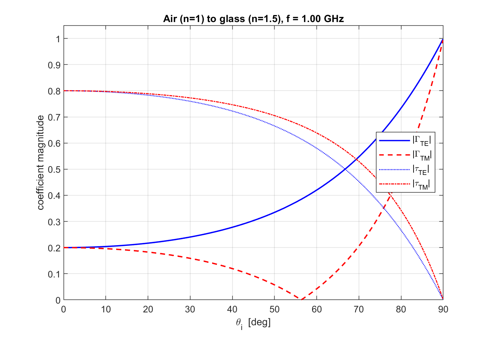

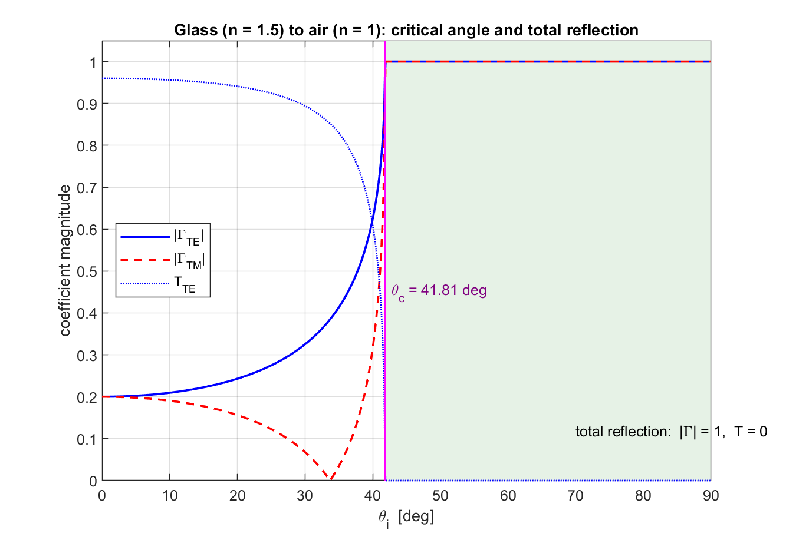

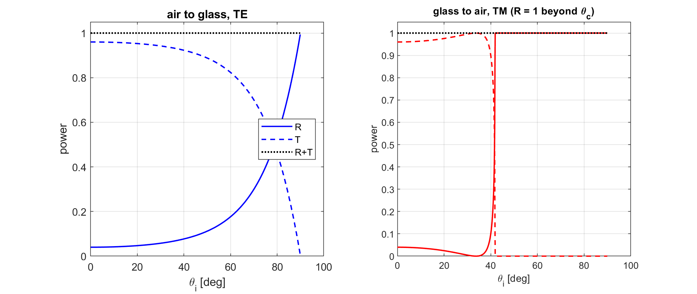

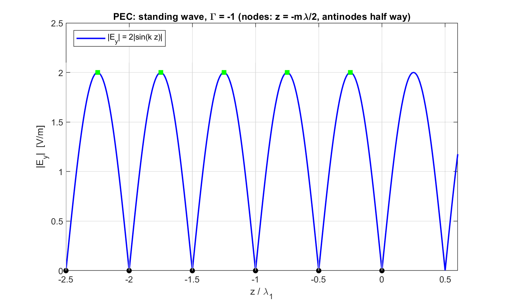

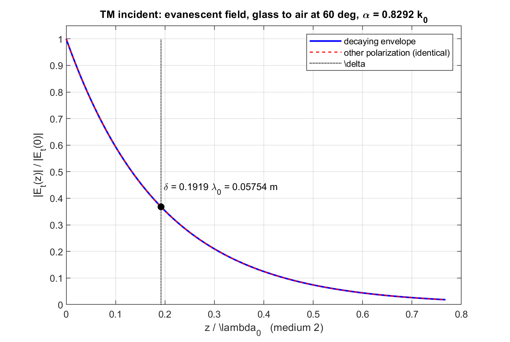

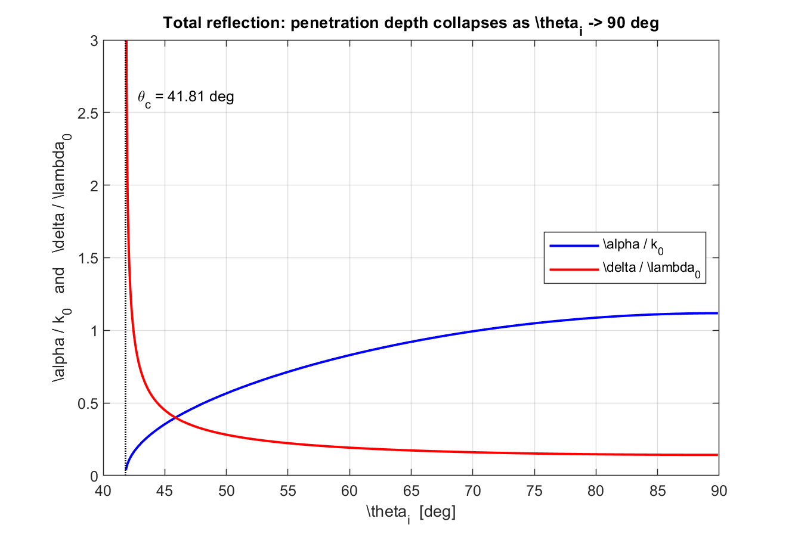

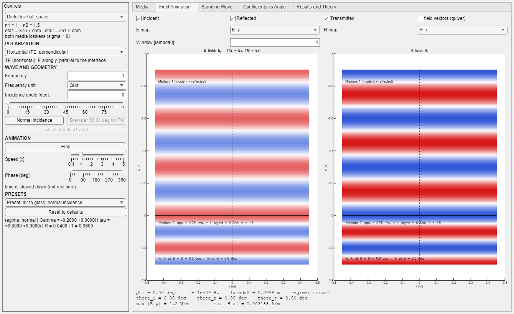

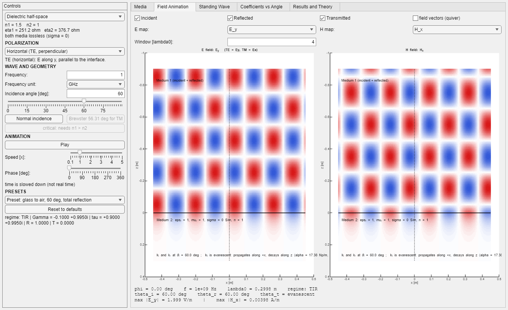

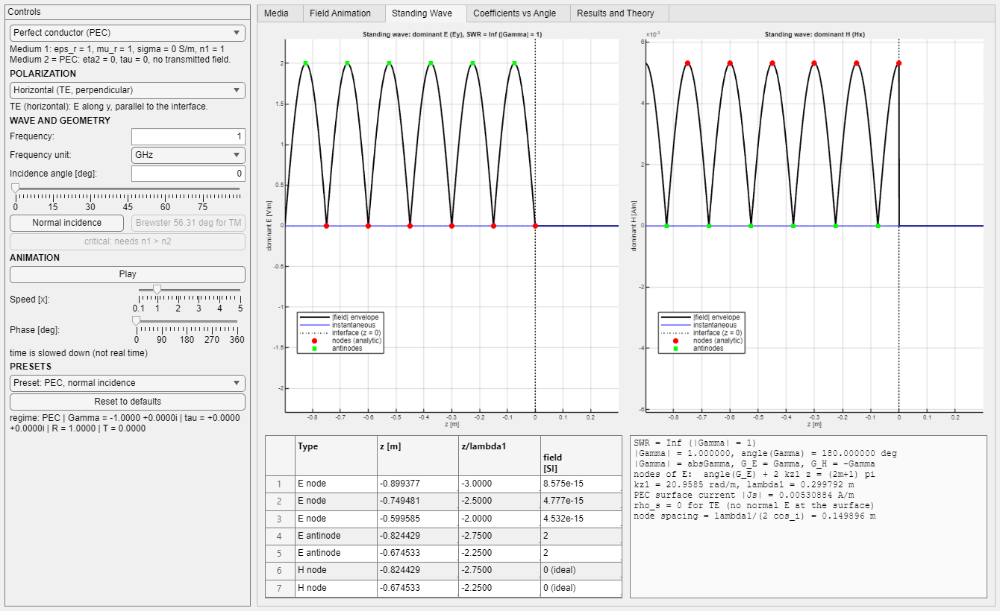

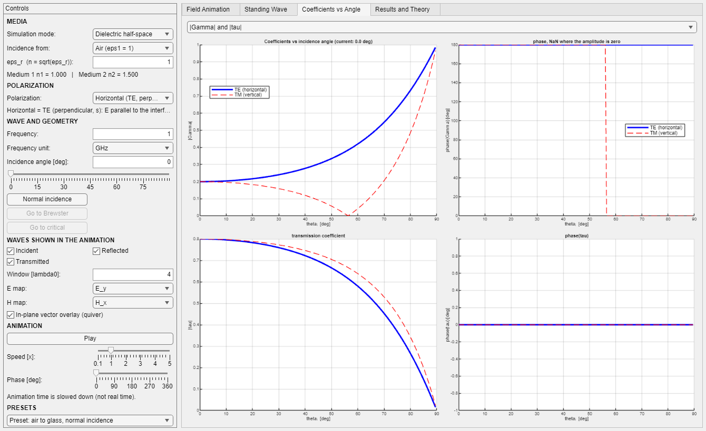

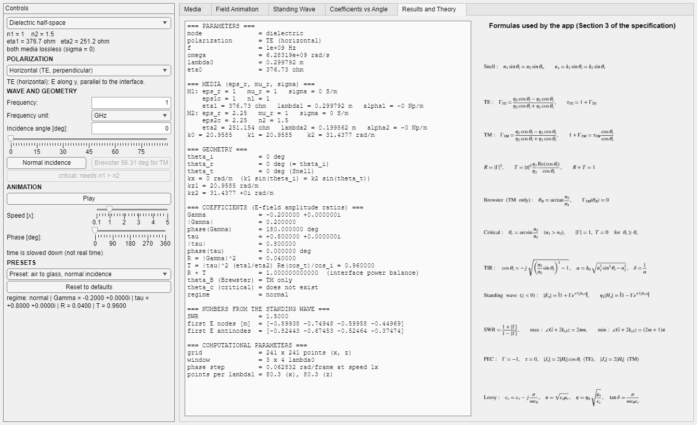

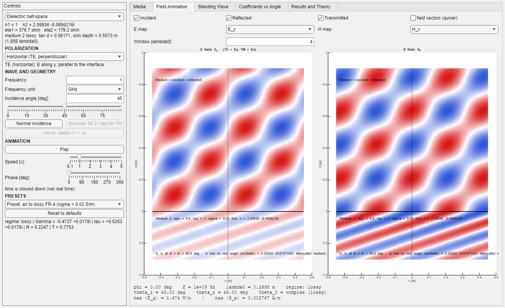

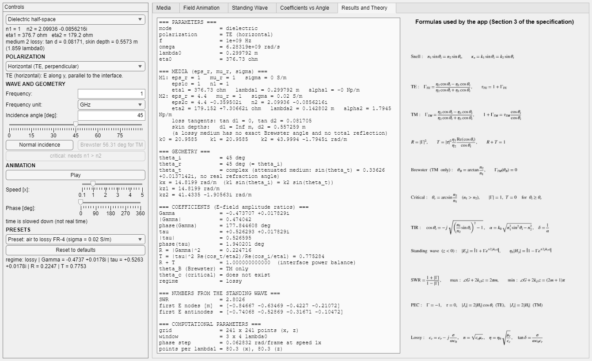

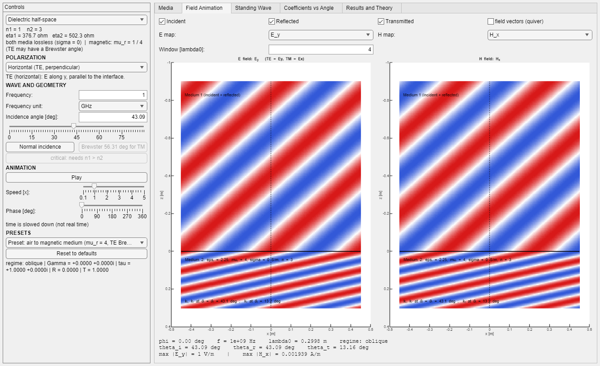

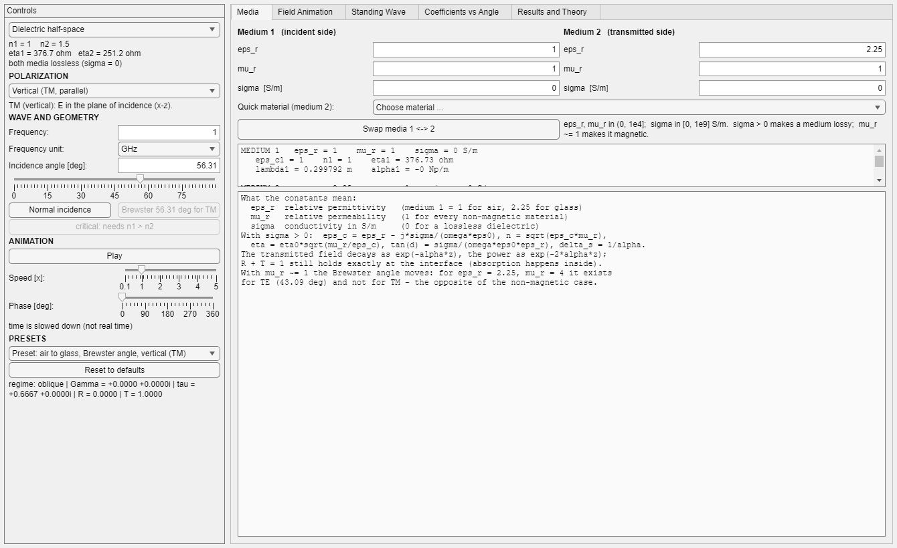

شکل‌های ۱ تا ۵ با `tests/gen_report_figures.m` در ۲۰۰ dpi ساخته شده‌اند و شکل‌های ۶ تا ۱۶ با `exportapp` از خود برنامهٔ در حال اجرا گرفته شده‌اند. جای قرار گرفتن هر تصویر در متن گزارش نهایی همین‌جاست و برای تکمیل، تصاویر گرفته‌شده روی رایانهٔ خودتان را نیز در همین‌جا اضافه کنید.

---

## ۷. محدودیت‌ها

۱) **اتلاف مغناطیسی مدل نشده است:** محیط مغناطیسی با `mu_r` حقیقی وارد می‌شود؛ تلفات مغناطیسی (بخش موهومی `mu`) و همچنین پاشندگی (وابستگی بسامدی `eps_r` و `mu_r`) در مدل نیست.

۲) **محیط با اتلاف نه زاویهٔ بروستر دقیق دارد و نه بازتاب کلی واقعی:** در `sigma > 0` ضریب `Gamma` مختلط است و صفر نمی‌شود؛ `|Gamma|` فقط یک کمینه دارد و برنامه هم زاویه‌ای گزارش نمی‌کند. همچنین رسانای واقعی همیشه بخشی از توان را می‌پذیرد، پس `|Gamma| = 1` و `T = 0` به‌معنای دقیق رخ نمی‌دهد و زاویهٔ بحرانی (و دکمهٔ «Go to critical») در این حالت تعریف نمی‌شود.

۳) **قرارداد علامت و مزدوج‌گیری در توان عبوری:** `T` از نسبت مؤلفهٔ عمودی پوینتینگ میانگین‌زمانی حساب می‌شود و در آن، در قطبش TE امپدانس `eta2` و در قطبش TM `conj(eta2)` ظاهر می‌شود. برای `eta` حقیقی (محیط بدون اتلاف) هر دو یکسان‌اند و به فرم آشنای `|tau|^2 (eta1/eta2) cos(theta_t)/cos(theta_i)` می‌رسند، اما برای نیم‌فضای رسانشی فقط همین صورت‌های مزدوج‌دار `R + T = 1` را نگه می‌دارند. ضمناً قرارداد `Gamma_TM` در این پروژه همان Cheng/Hayt/Ulaby است (`Gamma_TM = Gamma_TE` در فرود عمودی) و بعضی کتاب‌ها علامت آن را قرینه می‌گیرند؛ توان‌ها، اندازه‌ها و زاویه‌های ویژه به این قرارداد بستگی ندارند.

۴) **`eps_r < 1` فیزیکی نیست:** برای دسترسی به حالت بحرانی با محیط ۱ هوا پذیرفته شده، اما `n < 1` یعنی سرعت فاز بزرگ‌تر از سرعت نور و چنین دی‌الکتریک غیرفعال و بی‌اتلافی وجود ندارد؛ صرفاً مطالعهٔ پارامتری است.

۵) **صفر بودن `sigma` یک تصمیم عددی است:** «بدون اتلاف» فقط با `sigma = 0` دقیق برقرار است. اگر کاربر عدد کوچکی تایپ کند، مدل به‌درستی محیط را با اتلاف می‌بیند؛ برنامه عدد صفر را به‌طور خودکار به یک مقدار کوچک جابه‌جا نمی‌کند تا مرز بین دو مدل مبهم نشود.

۶) **`SWR` و فرم بستهٔ گره و شکم برای محیط ۱ با اتلاف معتبر نیستند:** در این حالت برنامه به‌جای عدد، «not defined» گزارش می‌کند و جدول گره و شکم را با مقادیر تحلیلی پر نمی‌کند.

۷) **زمان انیمیشن، زمان واقعی نیست:** فاز هر فریم `2π/100` رادیان در سرعت ۱× (بین ۰.۱× و ۵×) جلو می‌رود و مستقل از بسامد واقعی است؛ در ۱ گیگاهرتز دورهٔ تناوب واقعی ۱ نانوثانیه و نمایش بلادرنگ ناممکن است. تغییر بسامد فقط طول موج و مقیاس محورها (و تانژانت اتلاف و عمق پوست) را عوض می‌کند، نه سرعت نمایش.

۸) **زاویهٔ ۹۰ درجه پذیرفته نمی‌شود:** در فرود مماسی `cos(theta_i) = 0` و فرمول `T` و فاصلهٔ گره‌ها تکین می‌شود؛ بیشینهٔ مجاز ۸۹.۹ درجه است.

۹) **مدل دوبعدی موج تخت:** پراش، پرتوهای متناهی، محیط چندلایه و پدیده‌های سه‌بعدی در دامنهٔ پروژه نیستند.

---

## ۸. آنچه با اجرا تأیید شده و آنچه باقی مانده است

**تأییدشده با اجرا:** `tests/test_core.m` همهٔ آزمون‌های `T1` تا `T12` را در MATLAB **PASS** کرد (ثابت‌ها و محیط‌ها؛ مقادیر مرجع کتاب؛ شرط‌های مرزی روی آرایه‌های میدان با بیشینهٔ پرش `<= 6e-16` از جمله در بازتاب کلی؛ `R + T = 1` و پیوستگی مؤلفهٔ z بردار پوینتینگ میانگین‌زمانی؛ برابری فرم eta و فرم n؛ قانون اسنل و پایستگی `kx`؛ حدهای حدی؛ میدان میرای بازتاب کلی؛ تطابق گره‌ها و شکم‌ها با مقادیر تحلیلی؛ سازگاری منحنی زاویه‌ای با حل تک‌زاویه‌ای؛ و از آزمون‌های تازه: `T11` محیط با اتلاف و `T12` محیط مغناطیسی). `tests/smoke_gui.m` پیام **SMOKE TEST PASSED** با **۴۷ بررسی و صفر شکست** داد: رابط بدون نمایش ساخته شد، هر ده سناریوی آماده و هر دو قطبش پیموده شد، هر بار ۳۰ فریم انیمیشن جلو رفت، دادهٔ رسم‌شده برای `NaN`/`Inf` بررسی و پنجره بسته شد — **رابط گرافیکی به‌صورت خودکار و بدون نمایش (headless) اجرا شده است، نه تعاملی و دستی توسط انسان.** مقادیر مرجع هسته: هوا→شیشه (`eps_r = 2.25`، `n = 1.5`) در فرود عمودی `Gamma = -0.2`، `tau = 0.8`، `R = 0.04`، `T = 0.96`، `SWR = 1.5`؛ در ۴۵ درجه `Gamma_TE = -0.3033` و `Gamma_TM = -0.0920` با `theta_t = 28.13°`؛ `theta_B = 56.31°` با `Gamma_TM = 0` و `theta_i + theta_t = 90°`؛ شیشه→هوا `theta_c = 41.81°`؛ در ۶۰ درجه `|Gamma| = 1` برای دو قطبش و `T = 0` با `alpha = 0.8292 k0` و `delta = 0.1919 lambda0`؛ PEC در فرود عمودی `Gamma = -1`، `tau = 0`، `|E| = 2|sin(kz)|` با گره‌ها در `z = -m lambda1/2` و `|Js| = 2/eta0 = 0.005309 A/m`؛ FR-4 با اتلاف در ۱ گیگاهرتز `-Im(eps_c) = 0.3595`، `tan(delta) = 0.08171`، `alpha = 1.7945` Np/m و `delta_s = 0.5573` m با `R + T = 1` تا `1e-14` برای هر دو قطبش؛ آب دریا در ۱ گیگاهرتز `tan(delta) ≈ 0.89`؛ و محیط مغناطیسی با `eps_r2 = 2.25` و `mu_r2 = 4`: `n2 = 3`، `eta2 = 502.31` اهم، `Gamma` در فرود عمودی `0.1429`، زاویهٔ بروستر قطبش TE در `43.0887°` مطابق فرم بسته (`cos^2(theta_B) = 8/15`، اختلاف حل عددی و بسته حدود `1e-6` درجه) و **عدم وجود** زاویهٔ بروستر برای TM.

**باقی‌مانده برای تأیید روی رایانهٔ دانشجو:** اجرای `run_lab` و کار تعاملی با پنجره، لغزنده‌ها و دکمه‌های آماده روی نسخهٔ MATLAB خودتان (آزمون خودکار جای آزمون دستی را نمی‌گیرد)؛ پرکردن ستون «محاسبه دستی» جدول؛ افزودن تصاویر خودتان و مقایسه با شکل‌های کتاب درسی؛ انتخاب مقادیر `eps_r`، `mu_r` و `sigma` برای یک مادهٔ واقعی درس (مثلاً شیشه، آب یا FR-4) و مقایسهٔ `tan(delta)` و عمق پوست با جدول‌های مرجع؛ انطباق قرارداد علامت `Gamma_TM` با کتاب درس؛ ساخت نسخهٔ اجرایی مستقل (در صورت وجود MATLAB Compiler) یا ارائهٔ زندهٔ برنامه با `run_lab`.